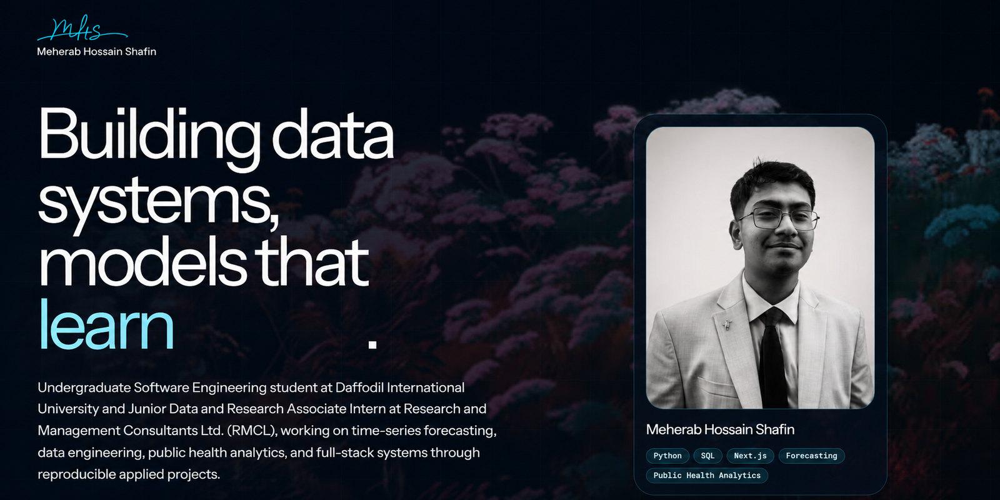

  

## Meherab Hossain Shafin

**Software Engineering undergraduate at Daffodil International University (CGPA 3.80/4.00, Dean's List) · Junior Data and Research Associate at RMCL · Systems Architect at Circle Technology Ltd · Dhaka, Bangladesh**

I build forecasting and decision-support systems for public health and energy, and I care about evaluating them honestly: rolling-origin validation, strong baselines, calibrated uncertainty and reproducible code. My research asks when added complexity actually improves a forecast, and my engineering work turns models into systems people can use.

[Portfolio](https://meherabhs.netlify.app) · [LinkedIn](https://www.linkedin.com/in/meherab-hossain-3b3416403/) · [Email](mailto:meherabhossainshafin@gmail.com)

---

## Research

**Do climate covariates improve national-scale dengue forecasting beyond autoregressive and seasonal structure? A 15-year time-series analysis from Bangladesh**  
M. H. Shafin · *Research Square preprint*, 2026 · [doi:10.21203/rs.3.rs-9022720/v1](https://doi.org/10.21203/rs.3.rs-9022720/v1) · [code](https://github.com/MeherabHS/bangladesh-dengue-forecasting)  
> SARIMA reached RMSE 0.736 vs 1.148 for naive persistence, with ~94% empirical coverage of 95% prediction intervals. Climate covariates added little once autoregressive and seasonal structure were modelled.

**Statistically Validated Multi-Horizon Electricity Load Forecasting with Weather-Augmented Machine Learning under Walk-Forward Evaluation**  
M. H. Shafin · *Research Square preprint*, 2026 · [doi:10.21203/rs.3.rs-9285801/v1](https://doi.org/10.21203/rs.3.rs-9285801/v1) · [code](https://github.com/MeherabHS/Statistically-Validated-Multi-Horizon-Electricity-Load-Forecasting-with-Weather-Augmented-ML)  
> Weather-augmented Gradient Boosting was the strongest model at every horizon (RMSE 166 at t+1 and 456 at t+168, vs 511 without weather at t+168). Presented at the DIU Research Poster Presentation, May 2026 (Certificate of Achievement).

---

## Featured work

| Project | What it is | Highlights |
|---|---|---|
| [**DengueOps AI**](https://github.com/MeherabHS/dengueops-ai-new) | Dengue early-warning and decision-support platform for Dhaka (in active development) | Forecasting pipeline with a seven-model rolling-origin comparison, web dashboard, mobile community reporting and vector-image classification. The follow-on system to the dengue study. |
| [**HelloDoctor**](https://github.com/MeherabHS/hellodoctor) | Telemedicine platform for Kenya | Rust (Axum, SQLx) API on PostgreSQL, Flutter patient and doctor apps, Next.js web apps, video consultations. Built with automated security testing and native ARM64 deployment checks. |
| [**Bangladesh air-quality forecasting**](https://github.com/MeherabHS/Bangladesh-air-quality-forecasting) | PM2.5 forecasting across 8 cities | Automated ingestion, SQLite storage, ARIMA/SARIMA with rolling-origin validation. |
| [**NYC taxi data engineering**](https://github.com/MeherabHS/nyc-taxi-data-engineering-postgresql) | ETL and analytics on 40.4M records (~3.9 GB) | PostgreSQL staging and analytics layers; B-tree indexing cut a representative query from ~1.2 s to 0.05 s. |

---

## Experience

**Junior Data and Research Associate**, Research and Management Consultants Ltd. (RMCL), Dhaka · Dec 2025 – present
- Data management team, Bangladesh Medical University HIV Test Kit Verification Study: Python analysis, interpretation of verification findings, sequential A1/A2/A3 testing approaches.
- Questionnaire implementation for an Ecological Momentary Assessment study (associated with the University of Georgia) and the IJM CSEC Baseline Study.
- Designed and built RMCL's Procurement and Consultant Repository, saving about 20 staff-hours per week of proposal preparation.

**Systems Architect and Software Engineer**, Circle Technology Ltd, Dhaka · Dec 2025 – present
- Architect and lead engineer of [HelloDoctor](https://github.com/MeherabHS/hellodoctor), a telemedicine platform: Rust API, PostgreSQL with row-level security, Flutter patient and doctor apps, Next.js web apps.
- Built the delivery pipeline: automated backend test suites, security scanning, disposable penetration-test stacks and native ARM64 image validation in CI.

---

## Skills

**Data science:** Python, pandas, NumPy, scikit-learn, statsmodels (SARIMA/ARIMA), time-series validation, SQL  
**Engineering:** PostgreSQL, Rust, TypeScript, Next.js, Flutter, Docker, CI/CD, Linux  
**Certifications:** [DataCamp Data Scientist](https://www.datacamp.com/certificate/DS0025952951169) · [IBM Data Science Professional Certificate](https://www.credly.com/badges/c529c874-15dc-4c7b-be6e-26cdb5848775/linked_in_profile)

## Honours

- Dean's List Award, Spring 2026, Faculty of Science and Information Technology, DIU
- Certificate of Achievement, DIU Research Poster Presentation, 2026
- Runner-up, 6th AUSTDC Nationals, 2024
- Champion and Runner-up, Inter-Cantonment National Debate Championship, 2024
- Campus Ambassador, Green Genesis 2026

---

Teaching side project: [Boxes & Bytes](https://meherabhs.github.io/boxes-and-bytes/), an interactive C and data structures course for beginners.
